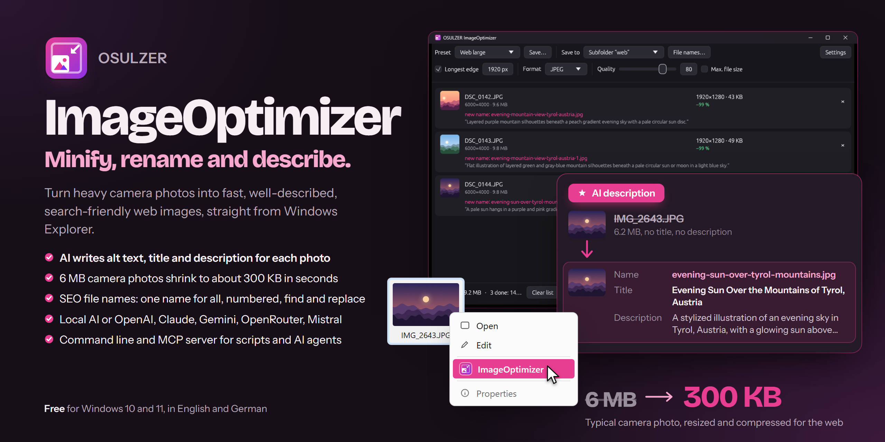

# OSULZER ImageOptimizer



[English](README.md) | Deutsch

Macht Kamerafotos per Rechtsklick webtauglich: Bilder im Explorer markieren, Rechtsklick,
„ImageOptimizer“. Ein Fenster zeigt alle markierten Bilder; eine Vorgabe wählen,
„Optimieren“ klicken. Die Ergebnisse landen im Unterordner `web` neben den Originalen, die
Originale bleiben unverändert.

Ein kostenloses Werkzeug von [OSULZER](https://www.osulzer.at) für Windows, macOS und Linux.

- Verkleinern auf eine längste Kante (nie vergrößern), JPEG, PNG oder WebP
- Qualität und optional eine maximale Dateigröße
- PNG: bei Qualität 100 verlustfrei, darunter mit reduzierter Farbpalette (oft 60–80 % kleiner)
- Kamera-Drehung wird eingerechnet, GPS- und Kameradaten werden entfernt, das Farbprofil bleibt
- Vorschau mit Vorher-Nachher-Vergleich und echter Ergebnisgröße, eigene Werte pro Bild
- Eigene Vorgaben speicherbar (`%APPDATA%\OSULZER\ImageOptimizer\config.json`)
- Oberfläche auf Englisch und Deutsch (beim ersten Start wie Windows, umschaltbar unter „Einstellungen“)

## KI-Beschreibung (optional)

Eine KI schlägt pro Bild Dateiname, Titel, Alt-Text und Beschreibung vor; die Texte erscheinen in der
Liste und lassen sich in der Seitenleiste bearbeiten. „Optimieren“ speichert das Bild dann unter dem
neuen Namen (klein, Bindestriche, höchstens 60 Zeichen; bei deutscher KI-Textsprache Umlaute ausgeschrieben) und schreibt die Texte
in die Metadaten (XMP, bei JPEG zusätzlich der Titel im EXIF).

- Einrichten: oben rechts „Einstellungen“ → „KI“, Anbieter wählen: OpenAI, Anthropic (Claude), Google Gemini,
  OpenRouter, Mistral, Ollama (lokal), LM Studio (lokal) oder ein eigener OpenAI-kompatibler Endpunkt. Zu jedem
  Anbieter zeigt der Reiter eine kurze Anleitung mit Link zum Schlüssel und zur Preisseite. Modell mit
  Bildverständnis wählen („Modelle laden“), dann „Verbindung testen“.
- API-Schlüssel liegen je Anbieter in der Windows-Anmeldeinformationsverwaltung, nicht in der Konfigurationsdatei.
- Datenschutz: Bei Cloud-Anbietern werden die Bilder (verkleinert auf 1024 px) an den Anbieter geschickt; das
  Programm fragt vor dem ersten Senden einmal nach. Ollama, LM Studio und Adressen im lokalen Netz gelten als lokal.
- Fehlermeldungen nennen die wahrscheinliche Ursache (Schlüssel abgelehnt, kein Guthaben, Modell kann keine Bilder,
  lokales Programm läuft nicht). Server, die keine feste JSON-Struktur kennen, werden automatisch ohne sie gefragt.
- Unten links neben „Optimieren“: Feld „Hinweis für die KI“ (Firma, Produkt, Ort; wird nicht
  gespeichert) und „KI-Beschreibung“. Ein lokales 27B-Modell braucht etwa 15–25 s pro Bild.
- WordPress ab 7.0 übernimmt beim Hochladen den Alt-Text (alle Formate) und bei JPEG den Titel.
  BanjoCMS liest die Metadaten derzeit nicht.

## Dateinamen-Regeln

Oben „Dateinamen…“ öffnet eine Leiste, deren Regeln für alle Bilder der Liste gelten:

- **Einheitlicher Name** mit Laufnummer: „Badsanierung Müller“ ergibt `badsanierung-mueller-01.jpg`, `-02`, …
  (ab 100 Bildern dreistellig). Gezählt wird in der Reihenfolge der Liste.
- **Präfix** und **Suffix** werden mit Bindestrich angefügt.
- **Suchen** und **Ersetzen durch**: einfacher Text, Groß- und Kleinschreibung egal, alle Vorkommen
  (z. B. „IMG_“ durch nichts ersetzen).
- Danach wird der Name web-tauglich gemacht (klein, Bindestriche, höchstens 60 Zeichen; die Laufnummer
  bleibt immer erhalten). Ein KI-Name dient als Grundname, der einheitliche Name hat Vorrang; die KI-Texte
  landen trotzdem in den Metadaten.
- Die Liste zeigt „neuer Name: …“ vor dem Speichern. „Zurücksetzen“ stellt die Originalnamen wieder her.

## Kommandozeile und Agenten (MCP)

Ohne Fenster, z. B. für Skripte oder KI-Agenten mit Terminal:

```
osulzer-imageoptimizer optimize fotos\*.jpg --preset web-medium --name "Badsanierung Müller" --json
osulzer-imageoptimizer optimize bild.jpg --format webp --target C:\Ausgabe --texts texte.json
osulzer-imageoptimizer presets
osulzer-imageoptimizer info bild.jpg
osulzer-imageoptimizer describe bild.jpg      # eingerichtete KI, nur mit Zustimmung aus dem Fenster
osulzer-imageoptimizer optimize --help
```

- Ohne Angaben gelten feste Standardwerte (Vorgabe `web-large`, Ziel Unterordner `web`, keine Namensregeln),
  nicht der Zustand des Fensters. Originale werden nur mit `--target replace` ersetzt; vorhandene Dateien
  bekommen einen Zähler.
- `--texts` liest `[{"path": "...", "file_name": "...", "title": "...", "alt": "...", "description": "..."}]`.
- Exit-Code 0 = alles gut, 1 = mindestens ein Bild fehlgeschlagen, 2 = falscher Aufruf oder KI nicht
  eingerichtet bzw. nicht freigegeben.
- `OSULZER_IMAGEOPTIMIZER_CONFIG` kann eine andere `config.json` vorgeben (für Skripte und Tests).
- Muster wie `fotos\*.jpg` löst das Programm selbst auf.
- Im Terminal getippt: Weil die Exe ein Fensterprogramm ist, wartet die Eingabeaufforderung nicht auf das Ende;
  die Ausgabe erscheint nachträglich und der Exit-Code wird nicht gesetzt. Für Skripte die Ausgabe umleiten
  (`… --json > ergebnis.json`) oder `Start-Process -Wait` verwenden; Agenten lesen die Ausgabe ohnehin über eine Pipe.

**MCP-Server** für Claude Code, Claude Desktop und andere Agenten: `osulzer-imageoptimizer mcp` (stdio).
Werkzeuge `optimize_images`, `list_presets`, `image_info`, `describe_image`. Der Agent kann Alt-Text, Titel,
Beschreibung und Dateinamen selbst mitgeben, dann braucht es keinen eigenen KI-Schlüssel. Die fertigen
Einrichtungsbefehle stehen unter „Einstellungen“ → „Agenten“, z. B.
`claude mcp add osulzer-imageoptimizer -- "C:\...\osulzer-imageoptimizer.exe" mcp`.

## Installieren

1. `osulzer-imageoptimizer.exe` aus dem [neuesten Release](https://github.com/OSULZER/osulzer-imageoptimizer/releases/latest)
   herunterladen.
2. Starten. Windows SmartScreen kann warnen, weil die Exe noch nicht codesigniert ist: „Weitere
   Informationen“ → „Trotzdem ausführen“.
3. „Installieren“ bestätigen: Das Programm kopiert sich nach `%LOCALAPPDATA%\Programs\OSULZER\ImageOptimizer`,
   trägt den Rechtsklick-Eintrag „ImageOptimizer“, eine Verknüpfung im Startmenü und einen Eintrag unter
   Windows „Apps“ ein. Keine Administratorrechte nötig.

Unter Windows 11 erscheint der Eintrag unter „Weitere Optionen anzeigen“ bzw. sofort bei Shift+Rechtsklick.

### macOS

1. `osulzer-imageoptimizer-macos.zip` herunterladen (Intel und Apple Silicon) und entpacken.
2. Die App ist nicht von Apple beglaubigt. Beim ersten Start blockiert macOS sie: unter
   „Systemeinstellungen → Datenschutz & Sicherheit“ bei der Meldung zu ImageOptimizer „Dennoch öffnen“ klicken.
3. „Installieren“ bestätigen: Die App zieht nach `~/Applications` und trägt die Schnellaktion im Finder ein
   (Bilder markieren, Rechtsklick → „Schnellaktionen → ImageOptimizer“).

Bilder lassen sich auch ins Fenster ziehen. Deinstallieren unter „Einstellungen → Allgemein“.

### Linux

1. `osulzer-imageoptimizer-linux-x86_64.tar.gz` (oder `-arm64`) herunterladen und entpacken.
2. `./osulzer-imageoptimizer-linux-x86_64` starten und „Installieren“ bestätigen: Das Programm kommt nach
   `~/.local/share/OSULZER/ImageOptimizer`, mit Eintrag im Anwendungsmenü, „Öffnen mit“ für Bilder in allen
   Dateimanagern, Rechtsklick-Eintrag in Dolphin, Nautilus („Skripte“) und Nemo sowie dem Befehl
   `osulzer-imageoptimizer` in `~/.local/bin`.

Zum Speichern von API-Schlüsseln braucht es einen Schlüsseldienst (GNOME-Schlüsselbund oder KWallet).
Deinstallieren unter „Einstellungen → Allgemein“.

Updates: Das Programm prüft beim Start höchstens einmal am Tag bei GitHub, ob es eine neue Version gibt
(abschaltbar unter „Einstellungen“), und installiert sie nach einem Klick – nur mit gültiger Signatur.

Deinstallieren: Windows „Einstellungen“ → „Apps“ → „OSULZER ImageOptimizer“. Das Programm fragt, ob
auch Einstellungen und API-Schlüssel gelöscht werden sollen.

Umstieg vom früheren „Bildoptimierer“: Beim ersten Start übernimmt das Programm einmalig Einstellungen,
API-Schlüssel und Kontextmenü-Eintrag. Der alte Ordner `%APPDATA%\Bildoptimierer` bleibt liegen.

## Bauen

Voraussetzungen: Rust (stable, `x86_64-pc-windows-msvc`), Visual-Studio-Build-Tools, `nasm`
und `cmake` (für mozjpeg und libwebp).

```
cargo test
cargo build --release      # target\release\osulzer-imageoptimizer.exe, eine Datei ohne DLLs
```

Testbilder: `cargo run --example beispielbilder -- <ordner> [anzahl]`.
Programmsymbol neu zeichnen: `cargo run --example icon` (schreibt `assets/icon.ico` und `assets/icon.png`).
Abnahme von Hand: [docs/PRUEFLISTE.md](docs/PRUEFLISTE.md).

## Lizenz

Apache-2.0 mit der „Commons Clause“: Nutzung, auch gewerblich, Änderung und Weitergabe sind erlaubt; den
ImageOptimizer selbst oder eine Dienstleistung, die im Wesentlichen daraus besteht, zu verkaufen, ist nicht
erlaubt. Der Name „OSULZER“ ist nicht mitlizenziert. Details in [LICENSE](LICENSE) und [NOTICE](NOTICE).

---

Entwickelt von [OSULZER](https://www.osulzer.at).
