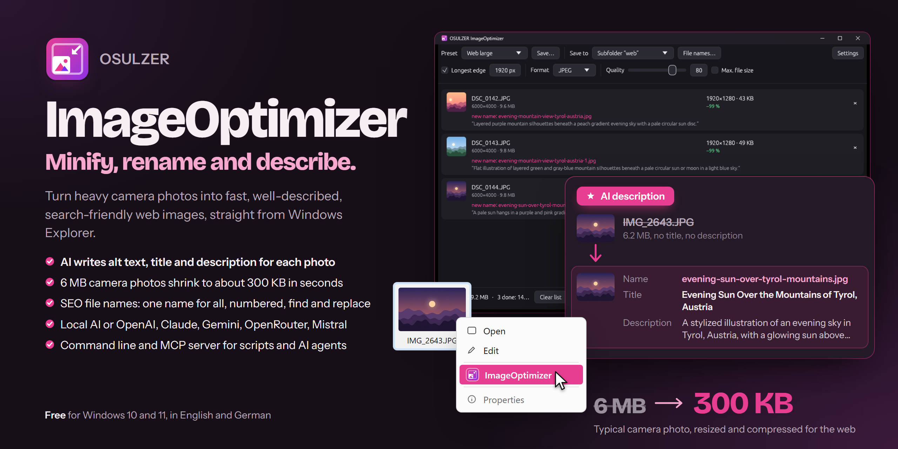

# OSULZER ImageOptimizer



English | [Deutsch](README.de.md)

Make camera photos web-ready with a right-click: select images in Explorer, right-click, choose
**ImageOptimizer**. A window lists the images; pick a preset and click **Optimize**. Results go to a `web`
subfolder next to the originals, which stay untouched.

A free tool by [OSULZER](https://www.osulzer.at) for Windows, macOS and Linux.

## Features

- Resize to a longest edge (never enlarges), JPEG, PNG or WebP, quality and an optional maximum file size
- PNG: lossless at quality 100, below that with a reduced colour palette (often 60–80% smaller)
- Camera rotation applied, GPS and camera data removed, colour profile kept
- Before/after preview with the real result size, own values per image, saved presets
- **File name rules** for all images: same name with running numbers (`kitchen-smith-01.jpg`, `-02` …),
  prefix, suffix, find and replace; the list shows the new name before saving
- **AI description** (optional): an AI suggests file name, title, alt text and description. The texts are
  written into the image metadata (XMP, EXIF title for JPEG); WordPress 7 picks up the alt text on upload.
  Providers: OpenAI, Anthropic (Claude), Google Gemini, OpenRouter, Mistral, Ollama and LM Studio (local),
  or any OpenAI-compatible endpoint. Images are only sent to a cloud provider after you allow it once.
- **Command line and MCP server** so scripts and AI agents (Claude Code, Claude Desktop …) can optimize,
  rename and tag images on their own
- English and German user interface, automatic updates from GitHub (signed)

## Install

1. Download `osulzer-imageoptimizer.exe` from the [latest release](https://github.com/OSULZER/osulzer-imageoptimizer/releases/latest).
2. Start it. Windows SmartScreen may warn that the app is unknown (it is not code-signed yet): click
   **More info** → **Run anyway**.
3. Accept **Install**: the program copies itself to `%LOCALAPPDATA%\Programs\OSULZER\ImageOptimizer`, adds
   the context-menu entry, a Start-menu shortcut and an entry under Windows **Apps** for uninstalling. No
   administrator rights are needed.

On Windows 11 the entry is under **Show more options** (or Shift + right-click).

Uninstall via Windows **Settings → Apps**; you will be asked whether to keep your settings.

### macOS

1. Download `osulzer-imageoptimizer-macos.zip` (Intel and Apple Silicon) and unzip it.
2. The app is not notarized by Apple. On first start macOS blocks it: open **System Settings → Privacy &
   Security** and click **Open Anyway** next to the message about ImageOptimizer.
3. Accept **Install**: the app moves to `~/Applications` and adds the Finder Quick Action
   (right-click images → **Quick Actions → ImageOptimizer**).

Dragging images onto the window works too. Uninstall under **Settings → General**.

### Linux

1. Download `osulzer-imageoptimizer-linux-x86_64.tar.gz` (or `-arm64`) and unpack it.
2. Start `./osulzer-imageoptimizer-linux-x86_64` and accept **Install**: the program goes to
   `~/.local/share/OSULZER/ImageOptimizer`, adds an application-menu entry, **Open with** for images in every
   file manager, a right-click entry in Dolphin, Nautilus (**Scripts**) and Nemo, and the command
   `osulzer-imageoptimizer` in `~/.local/bin`.

Storing API keys needs a Secret Service (GNOME Keyring or KWallet). Uninstall under **Settings → General**.

Updates are checked once a day on all systems and only installed when their signature is valid.

## AI description

Open **Settings → AI**, choose a provider and follow the short guide shown there (where to get a key,
which model to pick). API keys are stored in the Windows Credential Manager, never in the settings file.
Then click **AI description** in the main window, optionally with a note (company, product, place).

## Command line and agents

```
osulzer-imageoptimizer optimize photos\*.jpg --preset web-medium --name "Kitchen Smith" --json
osulzer-imageoptimizer optimize photo.jpg --format webp --target C:\Output --texts texts.json
osulzer-imageoptimizer presets
osulzer-imageoptimizer info photo.jpg
osulzer-imageoptimizer describe photo.jpg
osulzer-imageoptimizer optimize --help
```

Without options, fixed defaults apply (preset `web-large`, `web` subfolder, no name rules). Originals are
only replaced with `--target replace`; existing files get a counter. Exit codes: 0 ok, 1 at least one image
failed, 2 usage or setup error. Because the program is a window application, an interactive terminal does
not wait for it; redirect the output (`… --json > result.json`) or use `Start-Process -Wait` in scripts.

**MCP server:** `osulzer-imageoptimizer mcp` (stdio) offers the tools `optimize_images`, `list_presets`,
`image_info` and `describe_image`. Agents can pass alt text, title, description and file name themselves,
so no extra AI key is needed. **Settings → Agents** shows the ready-to-copy setup for Claude Code and
Claude Desktop.

## Building

Requirements: Rust (stable, `x86_64-pc-windows-msvc`), Visual Studio Build Tools, `nasm` and `cmake`.

```
cargo test
cargo build --release      # target\release\osulzer-imageoptimizer.exe, a single file
```

Releases are built and signed by GitHub Actions, see [docs/RELEASE.md](docs/RELEASE.md).

## License

Apache License 2.0 with the **Commons Clause**: you may use (also commercially), modify and share the
software, but you may not sell it or a service whose value derives substantially from it. The name
"OSULZER" is not licensed and may not be used for modified versions. See [LICENSE](LICENSE) and
[NOTICE](NOTICE). Third-party licenses are listed in `THIRD-PARTY-LICENSES.html` in every release.

This software is based in part on the work of the Independent JPEG Group.

---

Made by [OSULZER](https://www.osulzer.at).
